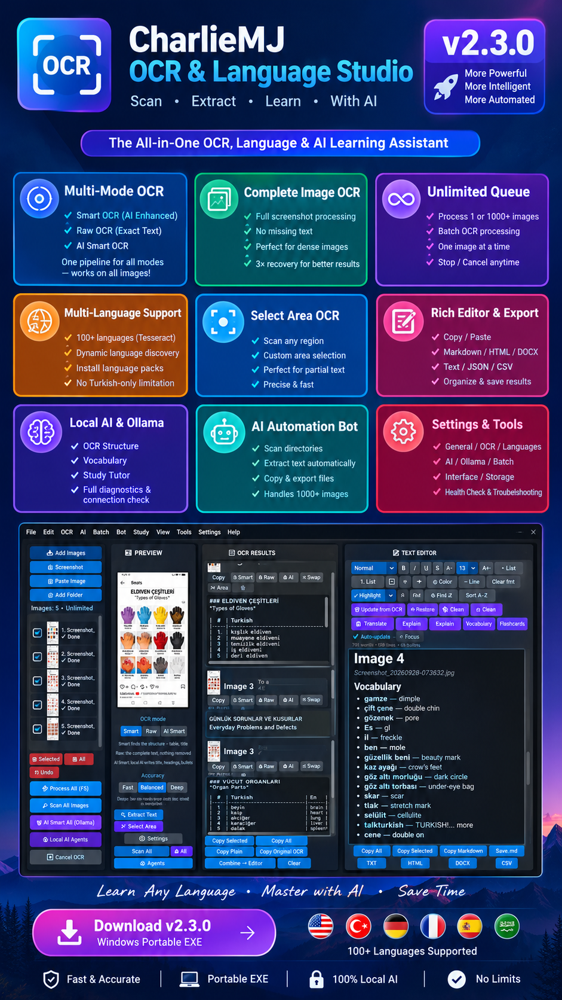
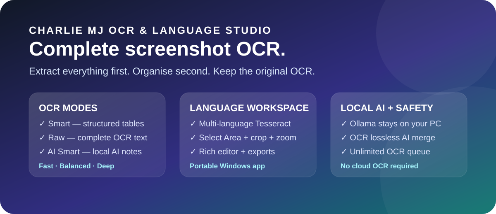
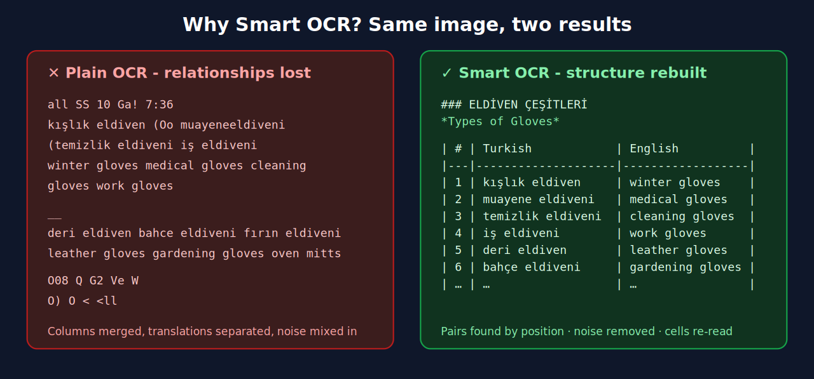
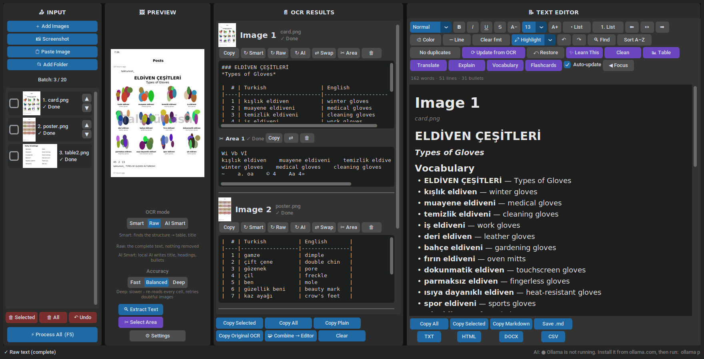

<!-- Charlie MJ OCR & Language Studio — current repository guide -->

<p align="center">
  
</p>

<h1 align="center">Charlie MJ OCR &amp; Language Studio</h1>

<p align="center">
  <b>Portable Windows OCR for language-learning screenshots, flashcards and vocabulary — complete extraction first, clean organisation second.</b>
</p>

<p align="center">
  
  
  
  
  
</p>

<p align="center">
  
</p>


 <p align="center">
  <a href="./downloads/charliemj-ocr-studio-v1.zip">
    
  </a>
  &nbsp;
  <a href="./downloads/CharlieMJ-OCR-Portable-v2.3.0.zip">
    
  </a>
  &nbsp;
  <a href="https://github.com/awsrmmustansarjavaid/charliemj-ocr-studio/actions/runs/38412578017/artifacts/11823197425">
    
  </a>
</p>

---

## What it does

**Charlie MJ OCR & Language Studio v2.3.0** turns screenshots and flashcards into organised language-learning notes.

The key rule is simple: **OCR the complete image first. Never use an expected vocabulary count as an extraction limit.** Structure detection, deduplication and optional AI formatting happen after the full OCR pass, so a screenshot containing 13, 20, 50 or more visible items can be processed without silently truncating valid OCR.





## Key features

- 🧠 **Three OCR modes** — **Smart**, **Raw** and **AI Smart**. All single-image buttons and **Process All** use the same OCR job pipeline.
- 🔎 **Complete screenshot OCR** — full-image extraction first, then bilingual structure, grid/cell re-reading and conservative missing-cell recovery.
- 🎚 **Fast / Balanced / Deep** — choose speed or stronger cell-level recovery. Balanced also has a targeted dense-screenshot structural retry.
- 🌍 **Dynamic language support** — installed Tesseract languages are discovered automatically; additional official language packs can be installed on demand.
- ♾️ **Unlimited OCR queue** — attach as many images as needed, reorder/remove/undo, and reprocess completed images.
- ✂️ **Select Area** — zoom, fit, pan, rotate, crop and draw multiple OCR regions; areas can stay attached to the source image.
- 📝 **Four-panel Text Editor** — automatic Image N sections, headings and vocabulary bullets, protected user edits, Find/Replace, Sort, duplicate removal, Focus and Restore.
- 📤 **Exports** — Markdown, TXT, HTML, DOCX and CSV vocabulary.
- 🤖 **Local AI** — optional Ollama AI Smart plus **OCR Structure**, **Vocabulary** and **Study Tutor** local agents.
- 🛡️ **AI lossless safety net** — OCR pairs omitted by AI are restored under **More vocabulary (from OCR)**.
- 💻 **Portable Windows build** — no installer or admin rights; GitHub Actions runs tests, frozen-EXE startup smoke testing, Defender scanning when available and SHA-256 generation.

## OCR modes

| Mode | Best for | Internet/AI |
|---|---|---|
| **Smart** | Clean bilingual tables, headings and complete grid recovery | Offline |
| **Raw** | Seeing the complete OCR capture | Offline |
| **AI Smart** | Polished titles, headings and vocabulary notes | Local Ollama only |

**Raw remains the source for comparison.** Smart and AI Smart organise the extracted information; they do not replace the original OCR.

## Supported language workflow

The bundled Windows build includes English, Turkish, Urdu, Arabic and Persian Tesseract data. The application also discovers installed Tesseract packs and can download additional official `tessdata_fast` packs when requested.

The OCR engine is language-aware; Turkish screenshots are only one test/use case, not a special OCR limit.

## Quick start

### Download the portable EXE

1. Click the **Download** button above.
2. Extract the ZIP.
3. Run **`CharlieMJ-OCR.exe`**.
4. The portable folder contains Tesseract and its language data; settings are saved beside the EXE.

### Run from source

```bash
pip install -r requirements.txt
python main.py
```

### Build the Windows EXE

Use **Actions → Build Windows portable EXE → Run workflow** or run `build.bat` on Windows. See [Installation](docs/INSTALLATION.md).

### Optional local AI

Install Ollama, pull a local model such as `gemma3:4b`, then use **Settings → Test AI connection**. OCR and the editor do not require Ollama.

## How to use

1. Add images, a folder, a pasted image or a screenshot.
2. Choose **Smart / Raw / AI Smart** and **Fast / Balanced / Deep**.
3. Press **Extract Text** for one image or **Process All** for the queue.
4. Review the **Image N** cards. Use **Swap** if bilingual columns are reversed.
5. Use **Select Area** for a difficult region.
6. Edit the generated notes in panel 4 and export/copy the final result.

## Privacy

OCR runs locally. Optional AI talks only to local Ollama. The only normal internet operation inside the app is an explicit request to install an additional Tesseract language pack. No cloud OCR API, telemetry, auto-start entry or administrator installation is required.

See [Security](docs/SECURITY.md).

## Documentation

| Document | Purpose |
|---|---|
| [Project Overview](docs/PROJECT_OVERVIEW.md) | Current product scope and principles |
| [Features](docs/FEATURES.md) | Current feature list |
| [OCR Modes](docs/OCR_MODES.md) | Smart, Raw, AI Smart and accuracy levels |
| [Smart OCR](docs/SMART_OCR.md) | Complete-image extraction and structure recovery |
| [Select Area](docs/SELECT_AREA.md) | Region selection, zoom, crop and multi-box OCR |
| [Text Editor](docs/EDITOR.md) | Editing, AI actions and exports |
| [Local AI](docs/LOCAL_AI.md) | Ollama setup and local agents |
| [AI Guide](docs/AI_GUIDE.md) | AI behaviour and safety rules |
| [Technologies](docs/TECHNOLOGIES.md) | Technology choices |
| [Architecture](docs/ARCHITECTURE.md) | Modules, OCR pipeline and concurrency |
| [Installation](docs/INSTALLATION.md) | Source and Windows build instructions |
| [User Guide](docs/USER_GUIDE.md) | Practical workflows |
| [Testing](docs/TESTING.md) | Regression, OCR and packaged-EXE tests |
| [Security](docs/SECURITY.md) | Privacy, checksums and antivirus notes |
| [Changelog](docs/CHANGELOG.md) | v2.3.0 changes and earlier history |
| [Roadmap](docs/ROADMAP.md) | Future work |

## Repository layout

```text
charliemj-ocr-studio/
├── app/                         application package
│   ├── batch_runtime.py         unified OCR queue/job runtime
│   ├── ocr_engine.py            Tesseract OCR
│   ├── ocr_recovery.py          dense-screenshot recovery
│   ├── layout.py                deterministic structure detection
│   ├── languages.py             language discovery / pack installation
│   ├── local_ai.py              local Ollama client
│   ├── local_agents.py          local AI roles
│   ├── editor.py + richtext.py  text editor and exporters
│   └── ui.py                    four-panel desktop UI
├── tests/                       regression and OCR tests
├── docs/                        current documentation
├── assets/                      screenshots, diagrams and thumbnail
├── downloads/                   verified portable build
├── .github/workflows/build.yml  Windows CI/build
├── build.bat                    local Windows build
├── requirements.txt             pinned runtime dependencies
└── main.py                      application entry point
```

## License

Released under the [MIT License](LICENSE).
