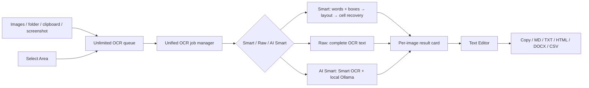

# Architecture

[← Main README](../README.md) · Previous: [Technologies](TECHNOLOGIES.md) · Next: [Security](SECURITY.md)

## Runtime flow

Single-image buttons and **Process All** now enter the same OCR job path. The queue runtime can process every attached image, including an image that already has a result, and keeps explicit start/result/error handling and diagnostics.

## Core modules

| Module | Responsibility |
|---|---|
| `config.py` | Portable paths and persistent settings. |
| `languages.py` | Installed-language discovery and official Tesseract language-pack installation. |
| `ocr_engine.py` | Tesseract word boxes, confidence, Raw OCR and cell re-reading. |
| `layout.py` | Deterministic structure detection, bilingual pairing, grid completion, notes and exports. |
| `ocr_recovery.py` | Targeted 3× structural retry for dense screenshots that initially look like plain text. |
| `batch_runtime.py` | Unified queue/job path, unlimited queue handling, cancellation, diagnostics and local-agent UI integration. |
| `job_manager.py` | Explicit OCR job lifecycle. |
| `local_ai.py` | Local Ollama client. |
| `local_agents.py` | Local OCR Structure, Vocabulary and Study Tutor roles. |
| `prompts.py` | AI Smart and editor-agent prompts. |
| `selector.py` | Zoom, fit, pan, rotate, crop and multi-box area selection. |
| `richtext.py` | Editor document model and MD/TXT/HTML/DOCX/CSV export. |
| `editor.py` | Formatted text editor and AI actions. |
| `ui.py` | Four-panel desktop interface and application state. |

## OCR architecture

Smart OCR always begins with a **complete-image OCR pass**. Structure and deduplication happen after extraction; a vocabulary reference count is never used as an OCR cap.

Balanced mode can re-read every detected grid cell and the dense-screenshot recovery module can perform one bounded 3× structural retry when the first pass produces substantial text but no reliable table. Deep mode adds additional language-specific voting and larger-scale retry.

AI Smart is downstream of OCR. The local model may organise or correct obvious OCR mistakes, but the deterministic lossless merge compares the AI output with OCR pairs and restores missing pairs under **More vocabulary (from OCR)**.

## Language architecture

The application discovers installed Tesseract languages and exposes friendly names. Official `tessdata_fast` language packs can be downloaded into the portable `tesseract/tessdata` directory on demand. The initial bundle contains English, Turkish, Urdu, Arabic and Persian data; additional installed packs can become selectable.

## Data model

Each top-level queue item keeps its image, name, status, OCR text, structured result, editable Markdown and captured areas. Captured areas remain children of the source image unless the user explicitly creates a new image.

`Image N` is derived from queue position, so deleting or reordering images renumbers cards and editor sections automatically.

## Threading

Tkinter widgets are only changed on the UI thread. OCR and AI work in background threads; results and errors are posted back to the UI queue. The job manager prevents overlapping OCR job sets and provides cancellation.

## Build and verification

GitHub Actions builds on Windows with Python 3.11, bundled Tesseract data, the complete unittest suite, an informational OCR integration test, PyInstaller, packaged-EXE startup smoke testing, Defender scanning and SHA-256 checksums.

The current packaged build is produced as `charliemj-ocr-studio-v2-final.zip`.
