# Smart OCR — Complete Screenshot to Structured Vocabulary

[← Main README](../README.md) · See also: [OCR Modes](OCR_MODES.md) · [Architecture](ARCHITECTURE.md)

Smart OCR is deterministic layout processing on top of Tesseract. It keeps word positions and confidence so the program can reconstruct relationships that ordinary plain OCR loses.

## Pipeline

```mermaid
flowchart LR
    A[Image] --> B[Whole-image OCR]
    B --> C[Words + boxes + confidence]
    C --> D[Lines / blocks / pairs]
    D --> E[Noise and caption filtering]
    E --> F[Orientation + headings]
    F --> G[Grid / cell geometry]
    G --> H[Cell re-reading]
    H --> I[Missing cell / row recovery]
    I --> J[Structured table + other text]
```

## Complete-image rule

The first OCR pass reads the **complete screenshot**. The application does not stop because it has reached a reference vocabulary count. It extracts first, then structures and deduplicates afterwards.

This is important for screenshots containing 13, 20, 50 or far more visible items: the expected item count is not an OCR limit.

## Grid and cell recovery

For grid-like flashcards the engine uses detected cells to estimate columns and row spacing. Each cell can be re-read using a wider crop, and missing positions can be attempted again. The cleanest valid reading wins without cutting words at cell borders.

Balanced mode performs the normal cell-aware pass. Deep mode adds language-specific voting and larger-scale retry.

## Dense screenshot recovery

Some dense bilingual screenshots produce many OCR lines but fail the first structural classification. In Balanced mode `ocr_recovery.py` performs one bounded 3× retry with structural analysis. A relaxed classification gate is used only for this retry, and a whole-image result is accepted only when at least a table-sized set of bilingual rows is recovered.

## Language handling

The structure engine is language-aware but not hard-coded to Turkish. The selected Tesseract language determines the OCR and cell readers. Installed Tesseract packs are discovered dynamically; additional official packs can be installed on demand.

## Noise handling

Smart OCR is intentionally conservative around phone UI, social-media chrome, captions, symbols, watermarks and low-confidence fragments. Text that does not belong in the table can remain available through Raw OCR or the `Other text` output.

## AI safety net

AI Smart is downstream of Smart OCR. After AI formatting, OCR pairs are compared with the AI vocabulary. Missing pairs are appended under **More vocabulary (from OCR)**. This makes the AI layer additive rather than a lossy replacement for OCR.

## Limits

Smart OCR is geometry-based. Highly decorative layouts, tiny text and severe image compression can still require **Deep**, **Raw**, **Select Area** or manual editing. Always review AI output and important OCR results.
